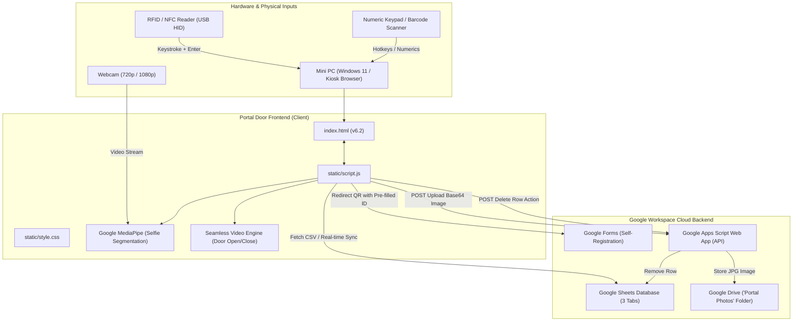

# 🚪 Portal Door — System Architecture & Integration Hand-off Guide

> **Version:** `v6.2`  
> **Production Live URL (GitHub Pages):** [https://socialmediumben.github.io/Portal-Door/](https://socialmediumben.github.io/Portal-Door/)  
> **Primary Repository:** [https://github.com/socialmediumben/Portal-Door](https://github.com/socialmediumben/Portal-Door)  
> **Target Form Factor:** Physical Interactive Kiosk / Digital Escape Door / Event Photo Booth

---

## 1. Project Overview

**Portal Door** is an interactive physical portal installation and web-based kiosk application. Designed to run on a dedicated mini-PC (e.g., AMD Ryzen or Intel Micro desktop) driving a vertical or horizontal display mounted inside or alongside a physical doorway frame.

### Key Capabilities
1. **Physical Card / RFID / NFC Integration:** Users tap RFID cards, badges, or scan barcodes. The kiosk parses standard USB HID keystrokes, initiates an animated door opening sequence, and displays the assigned digital experience (YouTube video, local/remote video loop, high-resolution image, or web content).
2. **Dynamic Cloud Database:** Backed by Google Sheets via real-time CSV endpoints. Content can be added, edited, or reordered instantly without rebuilding or redeploying code.
3. **Guest Self-Registration:** If an unregistered card/ID is scanned, the kiosk displays a customized Registration Screen featuring a dynamic QR code pointing to a Google Form pre-filled with the exact card ID.
4. **AI Real-Time Photobooth:** Pressing `*` activates an AI-powered chroma-less photobooth using Google MediaPipe Selfie Segmentation. It isolates the user in real time from their physical background and composites them into portal backdrops.
5. **Google Drive Cloud Sync & QR Delivery:** Captured photos are uploaded directly to Google Drive via Google Apps Script. A QR code is generated on-screen allowing guests to download their photo to their smartphone.
6. **Remote Media Deletion:** Pressing `-` opens a confirmation modal allowing authorized staff to delete unwanted media directly from the live Google Sheet.
7. **Fail-Safe Offline Mode:** If internet connectivity drops, the kiosk gracefully falls back to local JSON datasets (`media_data.json`) and cached assets.

---

## 2. System Architecture & Data Flow



---

## 3. Hardware & Kiosk Controls Map

The kiosk is optimized for a **USB Numeric Keypad** (or combined RFID reader that sends numeric digits followed by `Enter`). 

| Key | Event Code | Function | Context / Action |
|:---:|:---|:---|:---|
| **`/`** | `NumpadDivide`, `Slash` | **Home / Cancel** | Closes doors via transition video, resets active inputs, dismisses any open modal (Capture, Gallery, Delete), and exits Developer Mode. |
| **`(`** | `(`, `LaunchCalculator` | **Toggle Fullscreen** | Switches browser fullscreen mode on/off without conflicting with browser default `Esc`. |
| **`*`** | `*`, `NumpadMultiply` | **Photobooth Mode** | Toggles live webcam feed and MediaPipe background segmentation on/off. |
| **`+`** | `+`, `NumpadAdd` | **Snap Photo** | Starts 5-second countdown with loud audio beeps, triggers screen flash, and takes photo. |
| **`-`** | `-`, `NumpadSubtract` | **Delete Media** | Opens the Delete Confirmation modal for the currently visible media item. |
| **`Enter`** | `Enter`, `NumpadEnter` | **Trigger / Confirm** | Triggers media for entered ID. If input is empty, opens the **Backdrop Media Gallery**. Also confirms photo upload or deletion. |
| **`0` – `9`** | `Digit0-9`, `Numpad0-9` | **Select Backdrop** | Cycles through available backdrops in the Capture Modal or Backdrop Gallery. |
| **`.`** | `.`, `NumpadDecimal` | **Audio Toggle** | Toggles system sound on/off with on-screen visual toast notification. |
| **`)`** | `)` | **Reload Data** | Forces immediate re-fetch of all Google Sheet tabs and refreshes local cache. |
| **`Tab`** | `Tab` | **Developer Mode** | Toggles slide-out admin drawer showing raw dataset items, direct test clicks, and script configuration. |
| **`Esc`** | `Escape` | **Modal Cancel** | Cancels modals and closes Developer Mode without exiting fullscreen. |

---

## 4. Google Cloud & Spreadsheet Schema

The system connects to Google Sheets via standard public Google Visualization CSV export URLs (`/gviz/tq?tqx=out:csv`).

### Spreadsheet Configuration
- **Active Sheet ID:** `1vwXuw-TBYxUXKXUSipa2drArRNXZuKNwbXFhxcVbIc0`
- **Spreadsheet URL:** [Open Google Sheet](https://docs.google.com/spreadsheets/d/1vwXuw-TBYxUXKXUSipa2drArRNXZuKNwbXFhxcVbIc0/edit)

### Tab Schemas

#### 1. Tab: `Developer` (Master Curated Media)
| Column A (`ID`) | Column B (`Title`) | Column C (`Type`) | Column D (`File_Path`) |
|:---|:---|:---|:---|
| `101` | Forest Portal | `video` | `static/videos/forest.mp4` *(or Drive link)* |
| `102` | Cyberpunk City | `youtube` | `https://www.youtube.com/watch?v=dQw4w9WgXcQ` |
| `103` | Galaxy View | `image` | `https://drive.google.com/file/d/1A2B3C...` |

#### 2. Tab: `Users` (Community / Google Form Submissions)
Populated directly from Google Form responses. The frontend looks for flexible header names (`ID`, `Card ID`, `UID`, `Title`, `Media`, `File Path`, etc.).

#### 3. Tab: `Photobooth` (Selectable Backdrops)
Contains backdrop choices available to guests in the photobooth picker.
| Column A (`ID`) | Column B (`Title`) | Column C (`Type`) | Column D (`File_Path`) |
|:---|:---|:---|:---|
| `1` | Neon Portal | `image` | `https://lh3.googleusercontent.com/d/...` |
| `2` | Starfield | `image` | `static/images/space.jpg` |

---

## 5. Google Apps Script Backend (`google_apps_script.gs`)

The backend script acts as a serverless webhook for:
1. **Photo Uploads:** Accepts a JSON payload containing base64 image data, decodes it into a `.jpg` blob, saves it to a Google Drive folder named `"Portal Photos"`, grants public view access, and returns a high-speed direct CDN URL (`https://lh3.googleusercontent.com/d/{fileId}`).
2. **Spreadsheet Deletion:** Accepts `{ action: 'delete', id: '...' }`, locates the row across `Developer`, `Users`, or `Photobooth` sheets, and permanently deletes the row.

### Deployed Web App Endpoint
```
https://script.google.com/macros/s/AKfycbw8sI54Tsza9NwwLd-Id3DgGBg69L4N0VxwSp9d3_dryLdSB5CvmPGtPpzt2uymKRjwcQ/exec
```

> [!IMPORTANT]
> **One-Time Authorization for New Deployments:**  
> When modifying `google_apps_script.gs`:
> 1. Open Google Sheet $\rightarrow$ **Extensions** $\rightarrow$ **Apps Script**.
> 2. Paste updated code.
> 3. In the toolbar function dropdown, select **`testAuthorization`** and click **Run ▶️**.
> 4. Accept Google OAuth permissions ("Advanced" $\rightarrow$ "Allow").
> 5. Click **Deploy** $\rightarrow$ **Manage Deployments** $\rightarrow$ **Edit** $\rightarrow$ **New Version** $\rightarrow$ **Deploy**.

---

## 6. Directory Structure & Key Files

```text
Portal-Door/
├── .git/                      # Git repository tracking
├── index.html                 # Main kiosk entrypoint (v6.2)
├── app.py                     # Optional local Flask server
├── google_apps_script.gs      # Google Apps Script cloud webhook code
├── media_data.json            # Offline fallback dataset
├── requirements.txt           # Python dependencies (for app.py)
├── Procfile                   # Deployment configuration for Heroku/Render
└── static/
    ├── script.js              # Complete kiosk logic, MediaPipe, audio & hotkeys (v6.2)
    ├── style.css              # Custom neon dark-mode UI styling
    ├── images/
    │   └── Door Closed.png    # Idle screen graphic (closed doors)
    └── videos/
        ├── Door Open.webm     # Opening portal transition video
        └── Door Close.webm    # Closing portal transition video
```

---

## 7. How to Incorporate Portal Door into Other Projects

When embedding or extending this project into other solutions:

### Scenario A: Embedding as an Iframe / Kiosk Sub-View
Portal Door can be embedded directly into another web dashboard or container:
```html
<iframe 
    src="https://socialmediumben.github.io/Portal-Door/" 
    allow="camera; autoplay; fullscreen" 
    style="width: 100vw; height: 100vh; border: none;">
</iframe>
```
*Note: Make sure `allow="camera; autoplay; fullscreen"` is present so MediaPipe webcam access and fullscreen hotkeys function.*

### Scenario B: Integrating the MediaPipe Real-Time Photobooth
To reuse the background-replacement photobooth module in a separate application:
1. Include MediaPipe dependencies:
   ```html
   <script src="https://cdn.jsdelivr.net/npm/@mediapipe/camera_utils/camera_utils.js"></script>
   <script src="https://cdn.jsdelivr.net/npm/@mediapipe/selfie_segmentation/selfie_segmentation.js"></script>
   ```
2. Reference the segmentation pipeline in [`static/script.js`](file:///c:/Users/benbr/OneDrive/Desktop/Antigravity%20Code/Portal-Door/static/script.js#L217-L280) (`initSelfieSegmentation` and `onSelfieSegmentationResults`).

### Scenario C: Driving External Hardware (Microcontrollers / Arduino / ESP32)
If another project uses physical relays, LEDs (Neopixels), or magnetic door locks:
- Monitor keyboard input or listen to window postMessage events when doors open or close.
- In [`static/script.js`](file:///c:/Users/benbr/OneDrive/Desktop/Antigravity%20Code/Portal-Door/static/script.js#L651), hook into `playTransition(doorOpenVideoUrl)` to fire Web Serial API or WebSocket commands to your microcontroller.

---

## 8. Development & Local Run Instructions

### Option 1: Static Live Server (Recommended)
Because Portal Door is client-side rendered, you can run any local static file server:
```powershell
# Using Python
python -m http.server 8000
```
Then navigate to `http://localhost:8000/`.

### Option 2: Running with Flask Backend
```powershell
# Activate or create virtual environment
python -m venv venv
.\venv\Scripts\Activate.ps1
pip install -r requirements.txt

# Run Flask development server
python app.py
```
Open `http://127.0.0.1:5000/`.

---

## 9. Version History & Changelog

- **v6.2 (Current):**
  - Remapped `/` to Home Screen & Modal Dismissal.
  - Remapped `(` and `FN + Esc` to Fullscreen Toggle.
  - Added spreadsheet row deletion via `-` with `Enter` confirmation modal.
  - Integrated `testAuthorization` helper in Apps Script with detailed Google permission handling.
- **v6.1:**
  - Extended Photobooth countdown from 3s to 5s.
  - Added high-visibility circular countdown timer badge and louder audio tones.
- **v6.0:**
  - Added interactive Backdrop Media Gallery when `Enter` is pressed with an empty search bar.
  - Added auto-reset inactivity timers for all modal overlays.
- **v5.0 – v5.8:**
  - Integrated MediaPipe Selfie Segmentation for AI photobooth.
  - Google Drive upload and dynamic QR code generation.
  - Google Sheets multi-tab integration (`Developer`, `Users`, `Photobooth`).
